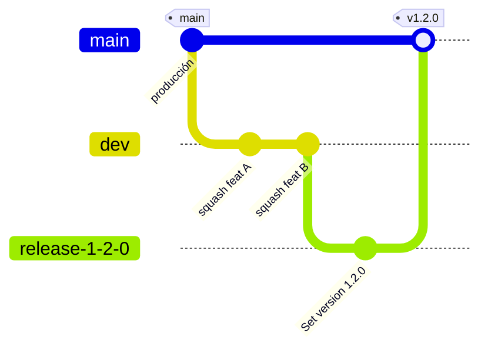
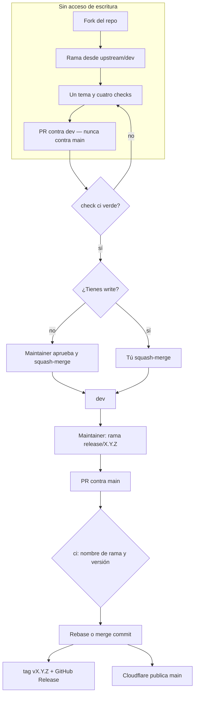

# Cómo contribuir

Este archivo es la fuente de verdad para cambiar el código. [README.md](./README.md) explica qué es el proyecto. [AGENTS.md](./AGENTS.md) solo apunta aquí. El detalle tributario, de arquitectura y de SEO vive en [`docs/`](./docs/).

## Principios (no negociables)

- **100 % en el navegador.** No hay backend, no hay formularios que posteen a ningún lado, no hay scripts de terceros. Los datos viven solo en memoria. Guardar en `localStorage` es opt-in y debe ir con un botón visible «Borrar mis datos».
- **Aviso en cada resultado:** «Tus datos no salen de tu navegador», «Es un proyecto de ley en trámite; puede cambiar», «Estimación aproximada, no es asesoría tributaria». Incluye la fecha «actualizado al» de los parámetros y el estado del proyecto de ley.
- **Código público:** licencia MIT, sin secretos, y cada cifra del motor cita su artículo (ET art. / PL 477 art.).
- **Simple por defecto, detalle a demanda.** El resultado principal va primero; el desglose completo va en `<details>`. Cada concepto tiene un tooltip en lenguaje llano.
- **Aislar el efecto de la reforma.** Compara ambos escenarios con los mismos UVT y SMLMV, para que la diferencia venga solo de la norma. Un interruptor secundario muestra los valores proyectados de 2027 y 2028.

## Flujo git

`dev` es la rama de integración y la **predeterminada** en GitHub. `main` es producción: Workers Builds publica el sitio desde ahí. Nadie empuja directo a `dev` ni a `main`.





Los PRs de trabajo se fusionan **solo con squash** hacia `dev`. El título del PR es el commit que queda. Squash hacia `main` está apagado: **rebase and merge** si la historia es lineal, **merge commit** si `main` tiene commits que la rama de release no tiene. En ese segundo caso, abre después un PR `main` → `dev` para no divergir.

No hay force-push a `dev` ni a `main`. En tu rama de feature sí puedes usar `--force-with-lease` para alinear con `upstream/dev`.

CI **no** exige reseñas. Quien tiene write fusiona sus propios PRs con `ci` verde. Un PR de fork necesita además una reseña de aprobación de alguien con write; esa aprobación es parte del merge, no un job de CI.

## Sin acceso de escritura (fork)

Los cambios de código van siempre a `dev`. No abras PRs contra `main`. No crees ramas `release/X.Y.Z`: eso lo corta quien publica.

1. Haz fork de `cdatehortuab/reforma-tributaria`.
2. Clona **tu** fork y declara el repo original como `upstream`:

   ```sh
   git clone git@github.com:<tu-usuario>/reforma-tributaria.git
   cd reforma-tributaria
   git remote add upstream git@github.com:cdatehortuab/reforma-tributaria.git
   git fetch upstream
   ```

3. Crea la rama desde `dev` actual, no desde `main`:

   ```sh
   git switch -c mi-cambio upstream/dev
   ```

4. Un PR, un tema. Si el proyecto de ley cambia, el título o la descripción deben citar el artículo y la fuente.
5. Corre los cuatro checks. El hook de pre-commit formatea lo que dejas en staging.
6. Publica en tu fork y abre el pull request **contra `dev`** de `cdatehortuab/reforma-tributaria`.
7. Espera el check `ci` en verde. Un maintainer deja la reseña y hace squash-merge. El título de tu PR es el mensaje del commit en `dev`: corto, en español o inglés, en modo indicativo, que explique el **porqué**.
8. Si `dev` avanzó mientras tanto:

   ```sh
   git fetch upstream
   git rebase upstream/dev
   git push --force-with-lease
   ```

El workflow de PRs a `main` no escribe `package.json` en un fork. No te afecta: tus PRs van a `dev`.

Para un error de cálculo usa la plantilla **Reportar error de cálculo**. Para código, el PR contra `dev`.

## Con acceso de escritura

Mismos cuatro checks y mismo destino `dev`. No hace falta fork. Fusionas tu PR cuando `ci` está verde, sin reseña.

### Release (`release/X.Y.Z` → `main`)

La versión la decide el nombre de la rama. Desde `dev`:

```sh
git switch -c release/1.2.0
```

Abre el PR contra `main`. `ci` exige que la rama se llame `release/X.Y.Z` y, si `package.json` aún no tiene esa versión, la escribe y la empuja al PR.

Al fusionar, el workflow **Release** lee `package.json`, crea el tag `vX.Y.Z` si no existe y el GitHub Release. Cloudflare publica ese push (un deploy por release: la versión ya iba en la rama).

Rollback en vivo: en el dashboard de Cloudflare, vuelve a la versión anterior del Worker. En git: corrige en `dev` y abre un `release/X.Y.Z` nuevo. No rebobines `main` ni muevas tags.

## Checks, en este orden, antes de dar un cambio por terminado

```sh
pnpm typecheck
pnpm lint
pnpm test
pnpm build
```

CI ejecuta los mismos cuatro. Viven en `.github/actions/checks` y los llaman dos workflows: PRs (cualquier base, para que un stack también tenga `ci`) y pushes a `dev`; PRs a `main` (este último además alinea la versión). `pnpm lint` usa `--max-warnings=0`: una advertencia falla el build. El gestor de paquetes es pnpm (`packageManager` en `package.json`); no uses `npm` ni `package-lock.json`.

El hook de pre-commit corre `eslint --fix` y `prettier --write` sobre los archivos en staging.

## Qué no editar ni commitear

- `dist/` es salida de `astro build`. No se versiona.
- `.astro/`, `.wrangler/`, `coverage/`, `node_modules/` y `.env*` tampoco.
- El lockfile es `pnpm-lock.yaml`. No commitees `package-lock.json`.
- Los scripts de build de dependencias se aprueban en `pnpm-workspace.yaml` (`allowBuilds`).
- No hay secretos en el repo. GitHub Actions corre el check `ci` y, en cada push a `main`, el workflow **Release** (tag `vX.Y.Z` + GitHub Release). Cloudflare Workers Builds publica producción desde `main` y previews desde `dev` y el resto de ramas.

## Mapa de `docs/`

No copies este material a README ni a AGENTS.md. Ábrelo cuando lo necesites:

| Archivo                                                    | Cuándo abrirlo                                                              |
| :--------------------------------------------------------- | :-------------------------------------------------------------------------- |
| [docs/reforma-tributaria.md](./docs/reforma-tributaria.md) | Qué cambia el PL 477 por tema, con artículo y vigencia                      |
| [docs/parametros.md](./docs/parametros.md)                 | Fuente y fecha de cada constante numérica; bitácora de actualizaciones      |
| [docs/engine.md](./docs/engine.md)                         | Estructura del motor, convención `{ total, lineas }`, cómo añadir un módulo |
| [docs/arquitectura.md](./docs/arquitectura.md)             | Por qué client-only + Workers Static Assets, CSP y privacidad               |
| [docs/seo.md](./docs/seo.md)                               | URLs, términos de búsqueda y cómo añadir una landing                        |
| [docs/decisiones.md](./docs/decisiones.md)                 | Decisiones ya tomadas, para no reabrirlas                                   |

## Cómo actualizar parámetros cuando el proyecto de ley se enmienda

1. Cambia `src/engine/params/proyecto.ts` (y, si aplica, `src/engine/params/constants.ts`). No pongas cifras en la lógica: van en datos.
2. Actualiza la fecha «actualizado al» en esos archivos y en la UI.
3. Anota la fuente (Gaceta, ponencia, texto aprobado) en `docs/parametros.md`.
4. Añade o ajusta fixtures en `tests/engine/` con el resultado esperado.
5. Corre los cuatro checks de arriba y abre un PR contra `dev`.

Si cambia la norma vigente y no el proyecto, el archivo es `src/engine/params/vigente.ts`.

## Motor de reglas

`src/engine/` es TypeScript puro: nada de React, nada de `astro:*`. ESLint lo impide (`no-restricted-imports` y `linterOptions.noInlineConfig`). No uses `any` ni `eslint-disable` ahí. Las funciones exportadas llevan tipo de retorno explícito (`@typescript-eslint/explicit-module-boundary-types`).
