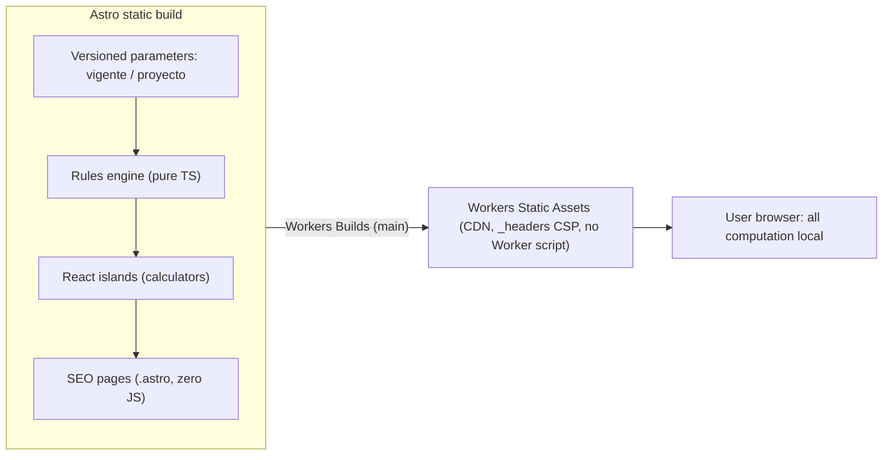

# Arquitectura

## Por qué client-only

El producto pide datos de salario, dependientes y gastos. Esos datos no deben salir del aparato. Sin backend no hay formulario que postee, no hay analítica de terceros por defecto y `connect-src 'none'` en CSP lo hace verificable. `localStorage` es opt-in, con «Borrar mis datos».

## Por qué Workers Static Assets

Cloudflare dirige proyectos nuevos aquí (Pages queda en mantenimiento). Servir solo archivos estáticos es ilimitado y gratuito. Las invocaciones de Worker script en el plan gratuito tienen tope (100.000/día), así que este sitio es **solo assets**: no hay `main`, no hay `run_worker_first`.

`wrangler.jsonc` apunta `assets.directory` a `./dist` y usa `not_found_handling: "404-page"` para respetar el 404 de Astro. `single-page-application` serviría `index.html` y ocultaría 404 reales.

En local: `pnpm wrangler:dev` (`astro build` + `wrangler dev`).

Producción: un PR `release/X.Y.Z` → `main`. Al fusionar, Workers Builds publica `main` y el workflow **Release** crea el tag `vX.Y.Z` y el GitHub Release. Un deploy por release porque la versión ya va en esa rama. El diagrama git y el flujo para forks están en [CONTRIBUTING.md](../CONTRIBUTING.md).

Previews: `dev` y PRs. GitHub no guarda un token de Cloudflare.

## CSP y privacidad

`public/_headers` se copia a `dist` y Workers lo aplica a las respuestas estáticas:

- `default-src 'self'`
- `connect-src 'none'` (nada de fetch, XHR ni beacons)
- `Referrer-Policy: no-referrer`
- `Permissions-Policy` restrictiva
- `X-Frame-Options: DENY`, `X-Content-Type-Options: nosniff`

`style-src` admite `'unsafe-inline'` porque Astro y Tailwind emiten estilos en línea en el HTML estático. No se afloja `script-src` ni `connect-src`. Ver `docs/decisiones.md`.

## Estructura del repo

| Ruta              | Rol                                                           |
| :---------------- | :------------------------------------------------------------ |
| `src/engine/`     | Motor puro, testeable sin UI                                  |
| `src/components/` | Islas React                                                   |
| `src/pages/`      | Landings SEO en `.astro` (JS en cero por defecto)             |
| `src/content/`    | FAQ, glosario y resúmenes de artículos (colecciones Markdown) |
| `src/layouts/`    | Cáscara HTML, `lang="es-CO"`                                  |
| `tests/engine/`   | Vitest                                                        |
| `public/_headers` | CSP y cabeceras                                               |
| `docs/`           | Conocimiento del proyecto que no va en README/CONTRIBUTING    |
